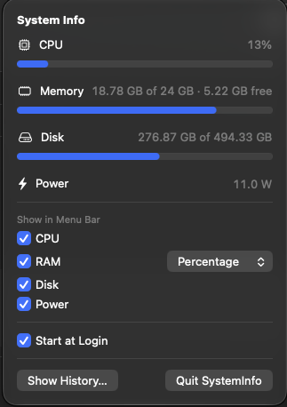
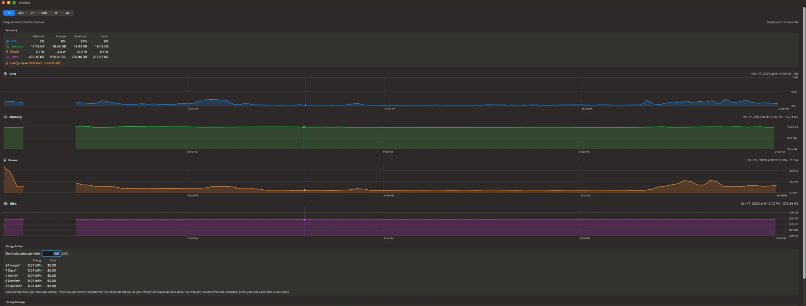

# SystemInfo – System Monitor for the macOS Menu Bar

SystemInfo is a small Mac app that lives in your menu bar. It shows **CPU, RAM, disk and power consumption** at a glance and keeps a **history**, so you can see how these values change over time, including how much energy your Mac uses while it sleeps.

> **Status: Beta (v0.6).** Things work, but expect rough edges. Feedback and bug reports are welcome in [Issues](https://github.com/Scharmen/IosSystemMonitor/issues).


## Screenshots

<p align="center">
  
</p>

<p align="center">
  
</p>

<p align="center">
  
</p>

---

## Features

**In the menu bar**
- Live values, updated every 2 seconds: ⚙️ CPU · 🧠 RAM · 💽 Disk · ⚡ Power (watts)
- You choose what's shown: tick the values you want in the panel
- RAM can be shown as **percentage**, **used**, **used / total** or **available**

**Click the menu bar item** to see all values with progress bars, the menu bar settings, and the **Show History…** button.

**History window**
- Charts for CPU, RAM, power and disk over **1 hour, 24 hours, 7 days, 30 days, 1 year or everything**
- **Drag across a chart to zoom in**, down to individual 30-second values
- Hover over a chart to see the exact time and value
- **Hide gaps:** a checkbox squeezes out the time your Mac was asleep or off, so the charts only show recorded time (the gaps stay visible as narrow bands)
- **Energy & cost:** total energy (kWh) used in the last 24 hours, 7 days, 1 month, 6 months and 12 months. Enter your electricity price per kWh to see what it costs. The table also shows the energy used while asleep and the average power draw during sleep
- Summary with minimum, average, maximum and latest value, plus the energy used and cost for the selected range
- **Sleep tracking:** every time your Mac sleeps you see when, how long, how much energy it used (Wh) and the average per hour of sleep

**Small storage footprint**
- The last **7 days** are kept in full detail (one value every 30 seconds)
- After that, older data is automatically condensed into **15-minute** averages (up to 90 days), then **hourly** averages
- **A whole year of history takes about 5 MB**, and every additional year about 1 MB more
- You choose how long history is kept: 1 day, 1 week, 1 month, 3 months, 1 year, **a custom number of years (1–50)** or unlimited
- Recording pauses automatically if your disk has less than 1 GB free

**Private by design:** all data stays on your Mac. The app makes no network connections.

---

## Requirements

- macOS 27 or later
- **Power values** need a Mac that reports its power consumption to macOS. This works on current Apple silicon Macs, including **desktops without a battery** such as the Mac mini. On Macs that don't report it, the power value simply shows "Not available"; everything else works as usual.

---

## Installation

1. Download **`SystemInfo-0.6.dmg`** from the [latest release](https://github.com/Scharmen/IosSystemMonitor/releases).
2. Open the DMG and drag **SystemInfo** onto the **Applications** folder.
3. Open SystemInfo from your Applications folder. It appears in the **menu bar** (top right), not in the Dock.

### "SystemInfo can't be opened" – what to do

This beta isn't signed with a paid Apple Developer ID, so macOS shows a warning the first time you open it. You only need to allow it once:

1. Try to open SystemInfo, then click **Done** in the warning.
2. Open **System Settings → Privacy & Security**.
3. Scroll down. Next to *"SystemInfo was blocked…"*, click **Open Anyway** and confirm.

<details>
<summary>Alternative: using Terminal</summary>

```bash
xattr -dr com.apple.quarantine /Applications/SystemInfo.app
```

</details>

### Start automatically at login (optional)

Tick **Start at Login** in the panel. Untick it to remove SystemInfo from your login items again. You can also manage it in **System Settings → General → Login Items**.

---

## Using SystemInfo

| What you want | How |
|---|---|
| See all values | Click the SystemInfo item in the menu bar |
| Change what's in the menu bar | Tick or untick **CPU / RAM / Disk / Power** in the panel |
| Change how RAM is shown | Use the drop-down next to **RAM** |
| Open the history | **Show History…** in the panel |
| Look at a short time span in detail | Drag across any chart in the history; **Reset Zoom** goes back |
| Set how long history is kept | **History Storage → Keep history for** at the bottom of the history window |
| See energy use and cost | **Energy & Cost** in the history window; enter your price per kWh to calculate costs |
| Delete all history | **Clear History…** at the bottom of the history window |
| Start at login | Tick or untick **Start at Login** in the panel |
| Quit | **Quit SystemInfo** in the panel (or ⌘Q while the panel is open) |

### About energy and cost

Energy totals add up the recorded power values, including sleep. They only cover time SystemInfo has recorded, and no further back than your **Keep history for** setting, so 6 and 12 months need a longer setting. Periods that aren't fully covered are marked with an asterisk.

### About sleep and power

While your Mac sleeps, macOS pauses all apps, so nothing can be measured *live* during sleep. SystemInfo therefore reads your Mac's built-in energy counters right before it falls asleep and again after it wakes up. From the difference it calculates:

- **Energy used** during the sleep, in watt-hours (Wh)
- **Average per hour** of sleep (Wh per hour, which is the same as the average watts)

This is calculated for sleeps of at least 15 minutes and appears 1–3 minutes after waking.

---

## Building from source

You need **Xcode 27** or later.

```bash
git clone https://github.com/Scharmen/IosSystemMonitor.git
cd IosSystemMonitor
open SystemInfo.xcodeproj
```

Then press **⌘R** to build and run.

To create the installable DMG and ZIP yourself:

```bash
./scripts/build-release.sh
```

The files are written to the `dist/` folder.

### Project structure

| File | Purpose |
|---|---|
| `SystemMonitor.swift` | Reads CPU, memory, disk and power from macOS |
| `HistoryRecorder.swift` | Saves values every 30 seconds, condenses old data, tracks sleep |
| `MetricSample.swift` | The data model for one stored value (SwiftData) |
| `HistoryView.swift` | The history window with charts, zoom and sleep list |
| `MenuBarLabel.swift` | What's drawn in the menu bar |
| `ContentView.swift` | The panel that opens from the menu bar |
| `MenuBarSettings.swift` | Menu bar options and RAM display formats |

### Where is the data stored?

```
~/Library/Containers/KraemerHome.SystemInfo/Data/Library/Application Support/
```

---

## License

[MIT](LICENSE) © 2026 Kevin Krämer
